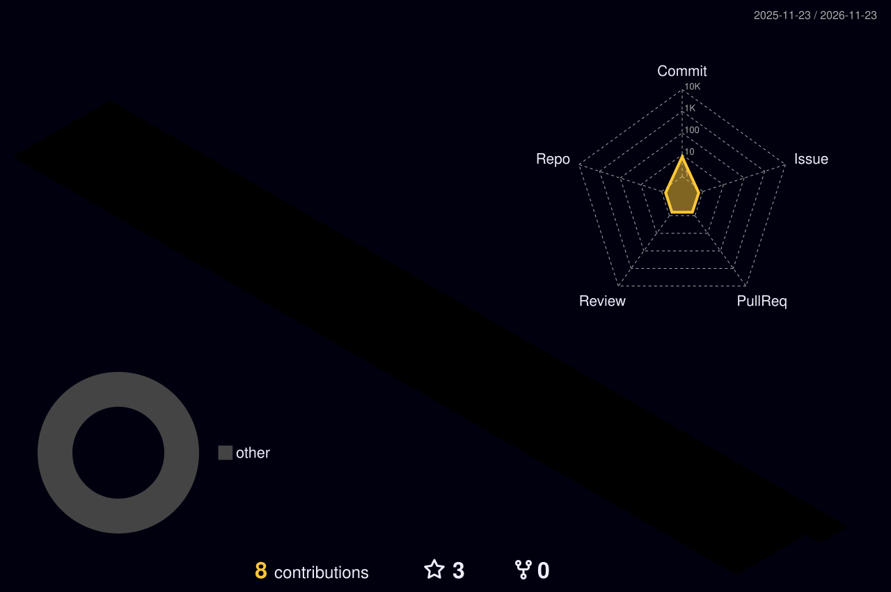

  
<h1 align="center">
   Hi there, 
  This is Ahmed Saeed Senior Frontend Specialist! 
</h1>

  

  

<h2 align="center">🛠️ Languages and Tools</h2>

  

<h2 align="center">🚀 Quick Facts</h2>

- 💻 MERN Stack Specialist & React.js Expert
- 🌱 Currently learning **Python, AI/ML**
- 👯 Looking to collaborate on **Open Source Projects**
- 💬 Ask me about **React, React Native, Node.js, Express, MongoDB**
- 📫 How to reach me: [ahmedsaeed0320@gmail.com](mailto:ahmedsaeed0320@gmail.com)
- ⚡ Fun fact: I debug code faster than I debug life!

<h2 align="center">📊 GitHub Statistics</h2>

  
  

  

<!-- 

  

    <h3>📌 Featured Projects</h3>
  

   

  

    
    
    
  

 -->

<h2 align="center">📈 Contribution Graph</h2>

## 🐍 The Hunt

<h2 align="center">🌐 Connect with me</h2>

  
  
  
  

<h3 align="center">
  

